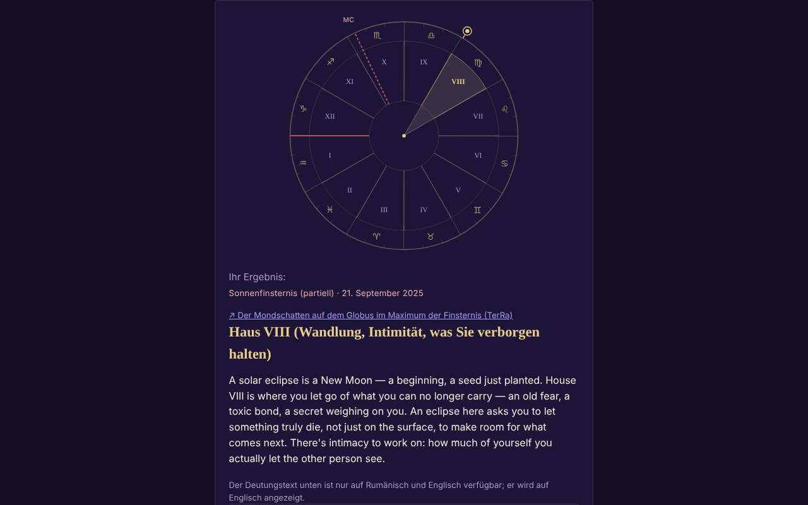

# ECLIPSA — dein Haus bei der Sonnen- oder Mondfinsternis

[English](README.md) · [Română](README.ro.md) · [Français](README.fr.md) · [Italiano](README.it.md) · [Español](README.es.md) · [Português](README.pt.md) · **Deutsch** · [Magyar](README.hu.md)

**Version:** 2.0.2 · **Zuletzt aktualisiert:** 2026-10-27

**Status:** stabil · **Offline:** vollständig (keine Netzwerkanfragen)

Oberflächensprachen: **Română, English, Français, Italiano, Español, Português (PT), Deutsch, Magyar**

Single-File-App, die anhand deiner Geburtsdaten ermittelt, in welches astrologische Geburtshaus eine Finsternis fällt (212 Finsternisse 2024–2070).

**Online:** https://chiuta.github.io/ECLIPSA/

## Was es ist

Lokale astronomische Berechnung (Sonne, Mond, Aszendent, MC, Häuser) plus symbolische Texte für jedes Haus. **Astrologie hat keine wissenschaftliche Validierung**: Die Deutungen sind Reflexion/Unterhaltung, keine Vorhersagen und keine medizinische, finanzielle oder rechtliche Beratung.

## Funktionen

- Deklarierte Häusersysteme: Ganzzeichen (Standard), gleiche Häuser, Placidus. Ohne Geburtszeit: Sonnenhoroskop (Ganzzeichen).
- Ungefähre Uhrzeit (Intervall, auch über Mitternacht hinweg): zeigt alle möglichen Häuser.
- Die Finsternisliste ist mit dem NASA-Katalog abgeglichen (Daten und Typen: 106 solare + 106 lunare, alle übereinstimmend); eine benutzerdefinierte Finsternis ist möglich.
- SVG-Rad, Kopieren/Herunterladen des Ergebnisses, RO/EN.
- „Nächste Finsternisse in deinen Häusern“: Nach der Berechnung eine einklappbare Tabelle mit den nächsten 12 Finsternissen (nach dem heutigen Datum, aus der enthaltenen NASA-Liste) und dem Geburtshaus, in das jede fällt, mit denselben Geburtsdaten und demselben Häusersystem (bei ungefährer Uhrzeit wird die Intervallmitte verwendet, mit Hinweis; ohne Uhrzeit das Sonnenhoroskop).
- Zeitzonenvorschlag aus der IANA-Datenbank des Browsers (historische Sommerzeit); das Feld füllt sich bei Wahl von Datum, Uhrzeit oder Stadt selbst und bleibt editierbar (ein von Hand eingegebener Wert wird nicht mehr überschrieben); die Schaltfläche „Vorschlagen…“ berechnet ihn jederzeit neu.

## Neue Funktionen (1.1.0)

Ein einklappbares Feld „Totale Sonnenfinsternis am 2. August 2027 — an deinem Ort“ unter den Ergebnissen (die kleine Variante des Feldes aus Eclipsa-2027), lokal mit `FFF.ephem` berechnet:

- **Lokale Umstände:** die Kontakte C1, C2, Maximum, C3, C4 (UTC und Ortszeit, wenn die Zeitzone bekannt ist), Größe, Bedeckung, Dauer der Totalität und der partiellen Phase, Höhe/Azimut der Sonne, Lage relativ zum Totalitätsstreifen. Der Ort: Suche in der Städteliste der App (Rumänien und Städte weltweit), Koordinaten `lat, lon`, die Schaltfläche „Ort aus dem Formular verwenden“ (bereits eingetragene Breite/Länge) oder GPS.
- **GPS mit ausdrücklicher Zustimmung in zwei Stufen** (Bestätigung in der Seite, dann eine einzige Anfrage); nichts wird gespeichert oder gesendet.
- **Countdown** bis zum nächsten Kontakt und Schaltfläche „Probe“ (simulierte Uhr, startet 30 s vor C2/Maximum).
- **`.ics`-Export** (Ereignis C1–C4 und bei Totalität C2–C3; optionale Alarme).
- **Checkliste für sicheres Beobachten** (mit Fortschritt; wird nicht gespeichert).
- **Einfache Karte des Streifens:** SVG mit der vereinfachten (dezimierten) Natural-Earth-Kontur (Küsten und Grenzen) (≈ 14 KB, gemeinfrei), dem von `FFF.ephem` berechneten Totalitätsstreifen und der Mittellinie, dem Punkt des globalen Maximums und deinem Ort. Es ist keine interaktive Karte und hat keinen Kachel-Hintergrund; die Kontur ist grob (dezimiert) und nicht geeignet, einen genauen Ort zu finden.
- Die Oberfläche hat 8 Sprachen (RO, EN, FR, IT, ES, PT, DE, HU), die im Sprachwähler ausgewählt werden. Die langen Deutungstexte bleiben in RO/EN (in den anderen Sprachen sieht man Englisch). Die Übersetzungen fr/it/es/pt/de/hu sind **automatisch und nicht von Muttersprachlern geprüft**.

## Bedienungsanleitung

1. Trage das Datum und (optional) die Geburtszeit ein; wähle die Stadt oder die Koordinaten.
2. Drücke „Zeitzone vorschlagen“ (du kannst sie von Hand korrigieren).
3. Wähle das Häusersystem und die Finsternis.
4. Drücke „Berechnen“.

## Datenschutz und Netzwerk

- Verwendet weder Speicher noch Cookies oder Konten; kein externer Host (CSP `connect-src 'none'`). Die Daten verlassen das Gerät nicht.
- Berechtigungen: keine beim Start; der Standort nur auf ausdrückliche Anforderung, nach Bestätigung in der Seite.

- 1.1.0: Die **Geolokalisierung** wird nur verwendet, wenn du „Meinen Standort verwenden (GPS)“ drückst und in der Seite bestätigst. Der `.ics`-Export wird lokal über einen `Blob` heruntergeladen. Es gibt keine neuen Netzwerkanfragen. Das Kit `fff-kit` (`core`, `label`, `bundle`, `ephem`) fügt die Transparenz-Schaltfläche hinzu; die App schreibt nichts in den Speicher (0 Schlüssel beim Start).
## Grenzen und Warnhinweise

- Genauigkeit, **gemessen** an 500 Daten zwischen 1900 und 2050 gegen JPL DE421 (scheinbare ekliptikale Länge): Sonne Mittel 0,4′, max. 1,1′ (≈0,02°); Mond Mittel 4,7′, 95. Perzentil 11,4′, max. 19,6′ (≈0,33°). Aszendent und Häuser (600 Daten und Orte, Breite ≤ 65°, gegen eine unabhängige geometrische Definition mit scheinbarer Sternzeit und wahrer Schiefe IAU 2006/2000A): Aszendent Mittel 0,20′, p95 0,41′, max. 2,05′ (≈0,03°); MC max. 0,31′; Placidus-Spitzen Mittel 0,18′, max. 0,81′; dasselbe Haus in 600/600 Fällen (Placidus, gleiche Häuser, ganze Zeichen). Die Finsternis-Uhrzeiten sind auf die Minute gerundet (±2 min, ohne praktische Auswirkung).
- Placidus ist oberhalb von ~66° Breite nicht definiert (die App lehnt ab); oberhalb von 89,5° gibt es keinen Aszendenten.
- Zeitzone: Vor ~1970 und am Tag der Zeitumstellung von Hand prüfen; Geburtsdatum ≥ 1900.
- Astrologie hat keine wissenschaftliche Grundlage.

- **Neue Funktionen, reale Grenzen.** Dieselben wie in Eclipsa-2027: Die Kontakte werden für Meereshöhe berechnet (Übereinstimmung mit der Referenz DE421: ≈ 1 s beim Maximum, ≤ 3 s bei den Kontakten an 10 Orten; ΔT ≈ ±1 s unsicher im Jahr 2027), ohne Gelände und ohne das Profil des Mondrandes; die Dauer der Totalität am Rand des Streifens ist sehr empfindlich. Der Countdown verwendet die Uhr des Geräts. Es ist kein Sicherheitswerkzeug und bietet keine medizinische Beratung; ISO-12312-2-Filter bleiben Pflicht.
- Die bestehende astrologische Berechnung (Häuser, NASA-Finsternisse 2024–2070) wurde **nicht** durch `FFF.ephem` ersetzt und nicht verändert; das neue Feld ist davon unabhängig. Die Städteliste enthält keine Orte auf der Totalitätsroute in Afrika (Luxor, Cádiz): Verwende die Koordinaten.
## Verlauf / Changelog

### 1.3.4 — 2026-10-22

fff-kit 1.1.4: Touch-Ziele und Mindestschriftgröße.

### 1.3.3 — 2026-10-22

fff-kit 1.1.2: PBKDF2 mit 600.000 Iterationen, Schutz vor Clickjacking.

### 1.3.2 — 2026-10-22
- Optionsfelder und Kontrollkästchen von 24 px; kleiner Text auf 12 px angehoben.

### 1.2.0 — 2026-10-19
- Neu: „↗ TerRa“ — bei Sonnenfinsternissen ein Link zu TerRa (2D-Karte) zum Zeitpunkt des Maximums, mit dem Mondschatten auf dem Globus; er enthält nicht den Geburtsort. Im Feld „Finsternis an deinem Ort — 2027“: derselbe Link, zum lokalen Maximum, mit dem gewählten Ort (auf ~1 km gerundet) als „Mein Standort“.

### 1.1.0 — 2026-10-14
- Neu: das Feld „Finsternis am 2. August 2027 an deinem Ort“ (lokale Umstände, Countdown + Probe, `.ics`-Export, Checkliste, einfache SVG-Karte des Streifens, GPS mit Zustimmung in zwei Stufen); Sprachzyklus RO/EN/HU/DE für die neuen Funktionen; `FFF.ephem` und `fff-kit` (`core`, `label`, `bundle`, `ephem`); `tests/fff-r8.test.mjs` (91 Prüfungen). Vorher/Nachher-Vergleich bei 1280×800: Die Startseite ist sichtbar unverändert (0 Pixel mit Unterschied über dem Schwellenwert; das Feld ist standardmäßig geschlossen), daher hat sich der Screenshot nicht geändert.

- 1.0.0 — 2026-10-12: Die Version und das Datum der letzten Aktualisierung werden in der App angezeigt
- Runde 7: Die Zeitzone bleibt nicht mehr leer, bis die Vorschlags-Schaltfläche gedrückt wird: Sie wird bei Änderung von Datum/Uhrzeit/Stadt automatisch (aus der IANA-Datenbank) ausgefüllt, solange sie nicht von Hand eingegeben wurde.
- Die Tabelle „Nächste Finsternisse in deinen Häusern“ (RO/EN) wurde hinzugefügt; CSP: `script-src` per SHA-256-Hash, ohne `'unsafe-inline'`.
- Selbstprüfung der Engine (11.10.2026, lokale Berechnung, keine externe Ephemeride): Die für die Finsternisse vom 8.04.2024, 2.10.2024 und 2.08.2027 berechnete Sonne steht bei ~19°24′ Widder, ~10°04′ Waage, ~9°55′ Löwe, passend zu Zeichen und Grad, in denen diese Finsternisse bekannt sind; der Abgleich mit einer externen Ephemeride bleibt ungelöst.
- Das Formular und die Ergebnisse sind in `<main>` eingefasst (Barrierefreiheits-Landmarke); axe-core: 0 Verstöße bei 1280 und 360 px.
- Die Standard-Finsternis in der Liste wird dynamisch gewählt (die jüngste vergangene Finsternis relativ zum aktuellen Datum); die Liste der 212 NASA-Finsternisse wurde nicht verändert.
- Ungelöst: Das Referenzergebnis (Haus V für die Finsternis vom 2. Oktober 2024) konnte nicht unabhängig erneut geprüft werden, da die Arbeitsumgebung keine externe Ephemeride hat.

## Tests

`node tests/fff-r8.test.mjs` (Playwright aus `/opt/node-tools`, lokales Chromium, Netzwerk gesperrt; `tests/_lib.mjs` enthält die gemeinsamen Hilfsfunktionen). Die Referenzwerte stehen in `tests/ref-c3a.json`: die lokalen Umstände für 10 Referenzorte (Kontakte C1–C4, Dauer, Bedeckung, Sonnenhöhe; JPL DE421, aus `fff-kit/test/ref`), die Zeitpunkte von Auf-/Untergang/Durchgang (Sonne, Mond; 5 Orte × 4 Daten), 56 Phasenzeitpunkte und 54 Alt/Az-Positionen, unabhängig mit **pyephem 4.2.1** berechnet (nur offline zur Erzeugung der Zahlen verwendet; kein Teil der App). Jeder Test hat seinen Schwellenwert im Code stehen; der Barrierefreiheitstest (axe-core, `bypassCSP`) läuft auch in geöffneten Dialogen/Feldern, bei 1280×800 und 360×740.

## Lokale Ausführung / offline

Lade `index.html` herunter und öffne sie im Browser.

## Lizenz

MIT — siehe Datei LICENSE. Dritte: Die Kontinentkontur im neuen Feld stammt von Natural Earth (gemeinfrei), dezimiert; `FFF.ephem` und `fff-kit` sind Code des Autors.

## Autor

Alexio — Alexandru-Ionuț Chiuță, Kontakt: alexio@trom.tf

## Zusammenfassung

Offline-Single-File-App, die ermittelt, in welches Geburtshaus (Ganzzeichen, gleich oder Placidus) eine Sonnen-/Mondfinsternis fällt, für 212 Finsternisse 2024–2070 (mit den NASA-Katalogen abgeglichen). Lokale Berechnung, ohne Speicher oder Netzwerk. Astrologie hat keine wissenschaftliche Validierung; die Deutungen sind symbolisch.
