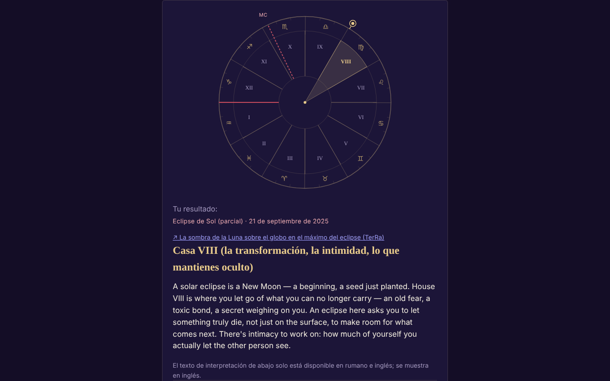

# ECLIPSA — tu casa en el eclipse de Sol o de Luna

[English](README.md) · [Română](README.ro.md) · [Français](README.fr.md) · [Italiano](README.it.md) · **Español** · [Português](README.pt.md) · [Deutsch](README.de.md) · [Magyar](README.hu.md)

**Versión:** 2.0.2 · **Última actualización:** 2026-10-27

**Estado:** estable · **Sin conexión:** completo (sin peticiones de red)

Idiomas de la interfaz: **Română, English, Français, Italiano, Español, Português (PT), Deutsch, Magyar**

Aplicación de un solo archivo que averigua en qué casa astrológica natal cae un eclipse (212 eclipses 2024–2070) a partir de tus datos de nacimiento.

**En línea:** https://chiuta.github.io/ECLIPSA/

## Qué es

Cálculo astronómico local (Sol, Luna, ascendente, MC, casas) más textos simbólicos para cada casa. **La astrología no tiene validación científica**: las interpretaciones son reflexión/entretenimiento, no predicciones ni consejo médico, financiero o jurídico.

## Funciones

- Sistemas de casas declarados: signos enteros (por defecto), casas iguales, Placidus. Sin la hora de nacimiento: carta solar (signos enteros).
- Hora aproximada (intervalo, incluso pasada la medianoche): muestra todas las casas posibles.
- La lista de eclipses está comprobada con el catálogo de la NASA (fechas y tipos: 106 solares + 106 lunares, todos coincidentes); es posible un eclipse personalizado.
- Rueda SVG, copia/descarga del resultado, RO/EN.
- «Próximos eclipses en tus casas»: tras el cálculo, una tabla plegable con los siguientes 12 eclipses (a partir de la fecha de hoy, de la lista NASA incluida) y la casa natal en la que cae cada uno, con los mismos datos de nacimiento y el mismo sistema de casas (para la hora aproximada se usa el punto medio del intervalo, con una nota; sin hora, la carta solar).
- Sugerencia de zona horaria a partir de la base de datos IANA del navegador (horario de verano histórico); el campo se rellena solo al elegir la fecha, la hora o la ciudad y sigue siendo editable (un valor escrito a mano ya no se sobrescribe); el botón «Sugerir…» lo recalcula en cualquier momento.

## Funciones nuevas (1.1.0)

Un panel plegable «Eclipse total del 2 de agosto de 2027 — en tu lugar», bajo los resultados (la versión reducida del de Eclipsa-2027), calculado localmente con `FFF.ephem`:

- **Circunstancias locales:** los contactos C1, C2, máximo, C3, C4 (UTC y hora local cuando se conoce la zona horaria), magnitud, oscurecimiento, duración de la totalidad y de la fase parcial, altura/acimut del Sol, posición respecto a la banda de totalidad. El lugar: búsqueda en la lista de ciudades de la aplicación (Rumanía y ciudades del mundo), coordenadas `lat, lon`, botón «Usar el lugar del formulario» (latitud/longitud ya rellenadas) o GPS.
- **GPS con consentimiento explícito en dos pasos** (confirmación en la página, luego una única solicitud); no se guarda ni se envía nada.
- **Cuenta atrás** hasta el siguiente contacto y botón «Ensayo» (reloj simulado, empieza 30 s antes de C2/máximo).
- **Exportación `.ics`** (evento C1–C4 y, en caso de totalidad, C2–C3; alarmas opcionales).
- **Lista de comprobación para observar con seguridad** (con progreso; no se guarda).
- **Mapa sencillo de la banda:** SVG con el contorno de Natural Earth (costas y fronteras) decimado (≈ 14 KB, dominio público), la banda de totalidad y la línea central calculadas por `FFF.ephem`, el punto del máximo global y tu lugar. No es un mapa interactivo y no tiene fondo de teselas; el contorno es grueso (decimado) y no sirve para encontrar un lugar exacto.
- La interfaz tiene 8 idiomas (RO, EN, FR, IT, ES, PT, DE, HU), que se eligen en el selector de idioma. Los textos largos de interpretación siguen en RO/EN (en los demás idiomas se ve inglés). Las traducciones fr/it/es/pt/de/hu son **automáticas y no verificadas por hablantes nativos**.

## Manual de uso

1. Rellena la fecha y (opcionalmente) la hora de nacimiento; elige la ciudad o las coordenadas.
2. Pulsa «Sugerir zona horaria» (puedes corregirla a mano).
3. Elige el sistema de casas y el eclipse.
4. Pulsa «Calcular».

## Privacidad y red

- No usa almacenamiento, cookies ni cuentas; ningún host externo (CSP `connect-src 'none'`). Los datos no salen del dispositivo.
- Permisos: ninguno al iniciar; la ubicación solo por petición explícita, tras confirmar en la página.

- 1.1.0: la **geolocalización** solo se usa si pulsas «Usar mi ubicación (GPS)» y confirmas en la página. La exportación `.ics` se descarga localmente mediante `Blob`. No hay nuevas solicitudes de red. El kit `fff-kit` (`core`, `label`, `bundle`, `ephem`) añade el botón de transparencia; la aplicación no escribe nada en el almacenamiento (0 claves al iniciar).
## Límites y advertencias

- Precisión **medida** en 500 fechas entre 1900 y 2050 frente a JPL DE421 (longitud eclíptica aparente): Sol media 0,4′, máx. 1,1′ (≈0,02°); Luna media 4,7′, percentil 95 11,4′, máx. 19,6′ (≈0,33°). Ascendente y casas (600 fechas y lugares, latitud ≤ 65°, frente a una definición geométrica independiente con tiempo sidéreo aparente y oblicuidad verdadera IAU 2006/2000A): ascendente media 0,20′, p95 0,41′, máx. 2,05′ (≈0,03°); MC máx. 0,31′; cúspides Placidus media 0,18′, máx. 0,81′; la misma casa en 600/600 casos (Placidus, casas iguales, signos enteros). Las horas de los eclipses se redondean al minuto (±2 min, sin efecto práctico).
- Placidus no está definido por encima de ~66° de latitud (la aplicación lo rechaza); por encima de 89,5° no hay ascendente.
- Zona horaria: comprueba a mano antes de ~1970 y el día del cambio de hora; fecha de nacimiento ≥ 1900.
- La astrología no tiene base científica.

- **Funciones nuevas, límites reales.** Los mismos que en Eclipsa-2027: los contactos se calculan para el nivel del mar (concordancia con la referencia DE421: ≈ 1 s en el máximo, ≤ 3 s en los contactos en 10 lugares; ΔT ≈ ±1 s incierto en 2027), sin relieve y sin el perfil del borde de la Luna; la duración de la totalidad en el borde de la banda es muy sensible. La cuenta atrás usa el reloj del dispositivo. No es una herramienta de seguridad y no ofrece consejo médico; los filtros ISO 12312-2 siguen siendo obligatorios.
- El cálculo astrológico existente (casas, eclipses NASA 2024–2070) **no** se sustituyó por `FFF.ephem` y no se modificó; el panel nuevo es independiente de él. La lista de ciudades no contiene lugares en la ruta de la totalidad en África (Luxor, Cádiz): usa las coordenadas.
## Historial / Changelog

### 1.3.4 — 2026-10-22

fff-kit 1.1.4: áreas táctiles y texto mínimo.

### 1.3.3 — 2026-10-22

fff-kit 1.1.2: PBKDF2 con 600.000 iteraciones, protección anti-clickjacking.

### 1.3.2 — 2026-10-22
- Botones de opción y casillas de 24 px; texto pequeño elevado a 12 px.

### 1.2.0 — 2026-10-19
- Nuevo: «↗ TerRa» — en los eclipses de Sol, enlace a TerRa (mapa 2D) en el momento del máximo, con la sombra de la Luna sobre el globo; no contiene el lugar de nacimiento. En el panel «Eclipse en tu lugar — 2027»: el mismo enlace, en el máximo local, con el lugar elegido (redondeado a ~1 km) como «Mi ubicación».

### 1.1.0 — 2026-10-14
- Nuevo: el panel «Eclipse del 2 de agosto de 2027 en tu lugar» (circunstancias locales, cuenta atrás + ensayo, exportación `.ics`, lista de comprobación, mapa SVG sencillo de la banda, GPS con consentimiento en dos pasos); ciclo de idiomas RO/EN/HU/DE para las funciones nuevas; `FFF.ephem` y `fff-kit` (`core`, `label`, `bundle`, `ephem`); `tests/fff-r8.test.mjs` (91 comprobaciones). Comparación antes/después a 1280×800: la página inicial no cambia visiblemente (0 píxeles con diferencia por encima del umbral; el panel está cerrado por defecto), por lo que la captura de pantalla no cambió.

- 1.0.0 — 2026-10-12: la versión y la fecha de la última actualización se muestran en la aplicación
- Ronda 7: la zona horaria ya no queda vacía hasta pulsar el botón de sugerencia: se rellena automáticamente (desde la base IANA) al cambiar la fecha/hora/ciudad, mientras no se haya escrito a mano.
- Añadida la tabla «Próximos eclipses en tus casas» (RO/EN); CSP: `script-src` por hash SHA-256, sin `'unsafe-inline'`.
- Autocomprobación del motor (11.10.2026, cálculo local, no una efeméride externa): el Sol calculado para los eclipses del 8.04.2024, 2.10.2024 y 2.08.2027 cae en ~19°24′ Aries, ~10°04′ Libra, ~9°55′ Leo, coherente con el signo y el grado en que se conocen estos eclipses; la verificación con una efeméride externa sigue sin resolverse.
- El formulario y los resultados están envueltos en `<main>` (punto de referencia de accesibilidad); axe-core: 0 infracciones a 1280 y 360 px.
- El eclipse predeterminado de la lista se elige dinámicamente (el eclipse pasado más reciente respecto a la fecha actual); la lista de 212 eclipses NASA no se modificó.
- Sin resolver: el resultado de referencia (casa V para el eclipse del 2 de octubre de 2024) no pudo reverificarse de forma independiente, porque el entorno de trabajo no tiene una efeméride externa.

## Pruebas

`node tests/fff-r8.test.mjs` (Playwright desde `/opt/node-tools`, Chromium local, red bloqueada; `tests/_lib.mjs` contiene las utilidades comunes). Los valores de referencia están en `tests/ref-c3a.json`: las circunstancias locales para 10 lugares de referencia (contactos C1–C4, duración, oscurecimiento, altura del Sol; JPL DE421, de `fff-kit/test/ref`), los instantes de salida/puesta/tránsito (Sol, Luna; 5 lugares × 4 fechas), 56 instantes de fase y 54 posiciones alt/az, calculados de forma independiente con **pyephem 4.2.1** (usado solo sin conexión para generar los números; no forma parte de la aplicación). Cada prueba tiene su umbral escrito en el código; la prueba de accesibilidad (axe-core, `bypassCSP`) se ejecuta también en diálogos/paneles abiertos, a 1280×800 y 360×740.

## Ejecución local / sin conexión

Descarga `index.html` y ábrelo en un navegador.

## Licencia

MIT — consulta el archivo LICENSE. Terceros: el contorno de los continentes del panel nuevo procede de Natural Earth (dominio público), decimado; `FFF.ephem` y `fff-kit` son código del autor.

## Autor

Alexio — Alexandru-Ionuț Chiuță, contacto: alexio@trom.tf

## Resumen

Aplicación de un solo archivo sin conexión que averigua en qué casa natal (signos enteros, iguales o Placidus) cae un eclipse solar/lunar, para 212 eclipses 2024–2070 (comprobados con los catálogos de la NASA). Cálculo local, sin almacenamiento ni red. La astrología no tiene validación científica; las interpretaciones son simbólicas.
