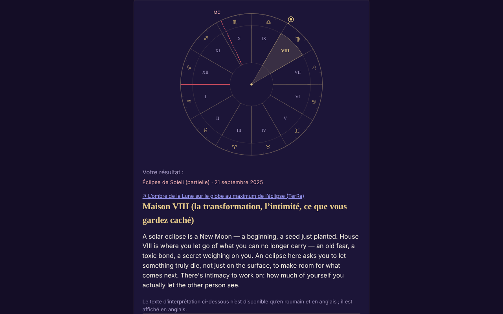

# ECLIPSA — votre maison lors de l'éclipse de Soleil ou de Lune

[English](README.md) · [Română](README.ro.md) · **Français** · [Italiano](README.it.md) · [Español](README.es.md) · [Português](README.pt.md) · [Deutsch](README.de.md) · [Magyar](README.hu.md)

**Version :** 1.3.3 · **Dernière mise à jour :** 2026-10-22

Langues de l'interface : **Română, English, Français, Italiano, Español, Português (PT), Deutsch, Magyar**

Application monofichier qui détermine dans quelle maison astrologique natale tombe une éclipse (212 éclipses 2024–2070) à partir de vos données de naissance.

**En ligne :** https://chiuta.github.io/ECLIPSA/

## Ce que c'est

Calcul astronomique local (Soleil, Lune, ascendant, MC, maisons) et textes symboliques pour chaque maison. **L'astrologie n'a pas de validation scientifique** : les interprétations relèvent de la réflexion/du divertissement, ce ne sont ni des prédictions ni des conseils médicaux, financiers ou juridiques.

## Fonctionnalités

- Systèmes de maisons déclarés : signes entiers (par défaut), maisons égales, Placidus. Sans l'heure de naissance : thème solaire (signes entiers).
- Heure approximative (intervalle, y compris au-delà de minuit) : affiche toutes les maisons possibles.
- La liste des éclipses est vérifiée par rapport au catalogue de la NASA (dates et types : 106 solaires + 106 lunaires, toutes concordantes) ; éclipse personnalisée possible.
- Roue SVG, copie/téléchargement du résultat, RO/EN.
- « Prochaines éclipses dans vos maisons » : après le calcul, un tableau repliable des 12 prochaines éclipses (après la date du jour, d'après la liste NASA incluse) et de la maison natale dans laquelle tombe chacune, avec les mêmes données de naissance et le même système de maisons (pour l'heure approximative, on utilise le milieu de l'intervalle, avec une note ; sans heure, le thème solaire).
- Suggestion de fuseau horaire à partir de la base IANA du navigateur (heure d'été historique) ; le champ se remplit tout seul quand vous choisissez la date, l'heure ou la ville et reste modifiable (une valeur saisie à la main n'est plus écrasée) ; le bouton « Suggérer… » le recalcule à tout moment.

## Nouvelles fonctionnalités (1.1.0)

Un panneau repliable « Éclipse totale du 2 août 2027 — chez vous », sous les résultats (version réduite de celui d'Eclipsa-2027), calculé localement avec `FFF.ephem` :

- **Circonstances locales :** les contacts C1, C2, maximum, C3, C4 (UTC et heure locale lorsque le fuseau est connu), magnitude, obscuration, durée de la totalité et de la phase partielle, hauteur/azimut du Soleil, position par rapport à la bande de totalité. Le lieu : recherche dans la liste de villes de l'application (Roumanie et villes du monde), coordonnées `lat, lon`, bouton « Utiliser le lieu du formulaire » (latitude/longitude déjà renseignées) ou GPS.
- **GPS avec consentement explicite en deux étapes** (confirmation dans la page, puis une seule demande) ; rien n'est enregistré ni envoyé.
- **Compte à rebours** jusqu'au prochain contact et bouton « Répétition » (horloge simulée, démarre 30 s avant C2/maximum).
- **Export `.ics`** (événement C1–C4 et, en cas de totalité, C2–C3 ; alarmes facultatives).
- **Liste de contrôle pour une observation en toute sécurité** (avec progression ; non enregistrée).
- **Carte simple de la bande :** SVG avec le contour Natural Earth (côtes et frontières) décimé (≈ 14 Ko, domaine public), la bande de totalité et la ligne centrale calculées par `FFF.ephem`, le point du maximum global et votre lieu. Ce n'est pas une carte interactive et elle n'a pas de fond de tuiles ; le contour est grossier (décimé) et ne convient pas pour trouver un lieu précis.
- L'interface compte 8 langues (RO, EN, FR, IT, ES, PT, DE, HU), choisies dans le sélecteur de langue. Les longs textes d'interprétation restent en RO/EN (dans les autres langues, c'est l'anglais qui s'affiche). Les traductions fr/it/es/pt/de/hu sont **automatiques et non vérifiées par des locuteurs natifs**.

## Mode d'emploi

1. Renseignez la date et (facultativement) l'heure de naissance ; choisissez la ville ou les coordonnées.
2. Appuyez sur « Suggérer le fuseau horaire » (vous pouvez le corriger à la main).
3. Choisissez le système de maisons et l'éclipse.
4. Appuyez sur « Calculer ».

## Confidentialité et réseau

- N'utilise ni stockage, ni cookies, ni comptes ; aucun hôte externe (CSP `connect-src 'none'`). Les données ne quittent pas l'appareil.
- Autorisations : aucune au démarrage ; la localisation uniquement sur demande explicite, après confirmation dans la page.

- 1.1.0 : la **géolocalisation** n'est utilisée que si vous appuyez sur « Utiliser ma position (GPS) » et confirmez dans la page. L'export `.ics` se télécharge localement via un `Blob`. Il n'y a pas de nouvelles requêtes réseau. Le kit `fff-kit` (`core`, `label`, `bundle`, `ephem`) ajoute le bouton de transparence ; l'application n'écrit rien dans le stockage (0 clé au démarrage).
## Limites et avertissements

- Précision ~0,01° (Soleil), ~0,1–0,3° (Lune, à titre indicatif). Les heures des éclipses sont arrondies à la minute (±2 min, sans effet pratique).
- Placidus n'est pas défini au-delà d'environ 66° de latitude (l'application refuse) ; au-delà de 89,5°, il n'y a pas d'ascendant.
- Fuseau horaire : vérifiez à la main avant ~1970 et le jour du changement d'heure ; date de naissance ≥ 1900.
- L'astrologie n'a aucune base scientifique.

- **Nouvelles fonctions, limites réelles.** Les mêmes que dans Eclipsa-2027 : les contacts sont calculés pour le niveau de la mer (concordance avec la référence DE421 : ≈ 1 s au maximum, ≤ 3 s aux contacts sur 10 lieux ; ΔT ≈ ±1 s d'incertitude en 2027), sans relief et sans profil du limbe lunaire ; la durée de la totalité au bord de la bande est très sensible. Le compte à rebours utilise l'horloge de l'appareil. Ce n'est pas un outil de sécurité et il ne donne aucun conseil médical ; les filtres ISO 12312-2 restent obligatoires.
- Le calcul astrologique existant (maisons, éclipses NASA 2024–2070) n'a **pas** été remplacé par `FFF.ephem` et n'a pas été modifié ; le nouveau panneau en est indépendant. La liste de villes ne contient pas de lieux sur le trajet de la totalité en Afrique (Louxor, Cadix) : utilisez les coordonnées.
## Historique / Changelog

### 1.3.3 — 2026-10-22

fff-kit 1.1.2 : PBKDF2 600 000 itérations, protection anti-clickjacking.

### 1.3.2 — 2026-10-22
- Boutons radio et cases à cocher de 24 px ; petit texte porté à 12 px.

### 1.2.0 — 2026-10-19
- Nouveau : « ↗ TerRa » — pour les éclipses de Soleil, lien vers TerRa (carte 2D) au moment du maximum, avec l'ombre de la Lune sur le globe ; il ne contient pas le lieu de naissance. Dans le panneau « Éclipse chez vous — 2027 » : le même lien, au maximum local, avec le lieu choisi (arrondi à ~1 km) comme « Ma position ».

### 1.1.0 — 2026-10-14
- Nouveau : le panneau « Éclipse du 2 août 2027 chez vous » (circonstances locales, compte à rebours + répétition, export `.ics`, liste de contrôle, carte SVG simple de la bande, GPS avec consentement en deux étapes) ; cycle de langues RO/EN/HU/DE pour les nouvelles fonctions ; `FFF.ephem` et `fff-kit` (`core`, `label`, `bundle`, `ephem`) ; `tests/fff-r8.test.mjs` (91 vérifications). Comparaison avant/après à 1280×800 : page initiale visiblement inchangée (0 pixel de différence au-dessus du seuil ; le panneau est fermé par défaut), donc la capture d'écran n'a pas changé.

- 1.0.0 — 2026-10-12 : la version et la date de la dernière mise à jour sont affichées dans l'application
- Tour 7 : le fuseau horaire ne reste plus vide jusqu'à l'appui sur le bouton de suggestion : il se remplit automatiquement (d'après la base IANA) lors d'un changement de date/heure/ville, tant qu'il n'a pas été saisi à la main.
- Ajout du tableau « Prochaines éclipses dans vos maisons » (RO/EN) ; CSP : `script-src` par hachage SHA-256, sans `'unsafe-inline'`.
- Autovérification du moteur (11.10.2026, calcul local, pas une éphéméride externe) : le Soleil calculé pour les éclipses du 8.04.2024, du 2.10.2024 et du 2.08.2027 tombe à ~19°24′ Bélier, ~10°04′ Balance, ~9°55′ Lion, en cohérence avec le signe et le degré dans lesquels ces éclipses sont connues ; la vérification par rapport à une éphéméride externe reste non résolue.
- Le formulaire et les résultats sont encadrés par `<main>` (repère d'accessibilité) ; axe-core : 0 violation à 1280 et 360 px.
- L'éclipse par défaut de la liste est choisie dynamiquement (l'éclipse passée la plus récente par rapport à la date courante) ; la liste de 212 éclipses NASA n'a pas été modifiée.
- Non résolu : le résultat de référence (maison V pour l'éclipse du 2 octobre 2024) n'a pas pu être revérifié de façon indépendante, car l'environnement de travail ne dispose pas d'éphéméride externe.

## Tests

`node tests/fff-r8.test.mjs` (Playwright depuis `/opt/node-tools`, Chromium local, réseau bloqué ; `tests/_lib.mjs` contient les utilitaires communs). Les valeurs de référence se trouvent dans `tests/ref-c3a.json` : les circonstances locales pour 10 lieux de référence (contacts C1–C4, durée, obscuration, hauteur du Soleil ; JPL DE421, issus de `fff-kit/test/ref`), les heures de lever/coucher/passage (Soleil, Lune ; 5 lieux × 4 dates), 56 instants de phase et 54 positions alt/az, calculés indépendamment avec **pyephem 4.2.1** (utilisé uniquement hors ligne pour générer les nombres ; ne fait pas partie de l'application). Chaque test a son seuil écrit dans le code ; le test d'accessibilité (axe-core, `bypassCSP`) s'exécute aussi dans les boîtes de dialogue/panneaux ouverts, à 1280×800 et 360×740.

## Exécution locale / hors ligne

Téléchargez `index.html` et ouvrez-le dans un navigateur.

## Licence

MIT — voir le fichier LICENSE. Tiers : le contour des continents du nouveau panneau provient de Natural Earth (domaine public), décimé ; `FFF.ephem` et `fff-kit` sont du code de l'auteur.

## Auteur

Alexio — Alexandru-Ionuț Chiuță, contact : alexio@trom.tf

## Résumé

Application monofichier hors ligne qui détermine dans quelle maison natale (signes entiers, égales ou Placidus) tombe une éclipse solaire/lunaire, pour 212 éclipses 2024–2070 (vérifiées par rapport aux catalogues de la NASA). Calcul local, sans stockage ni réseau. L'astrologie n'a pas de validation scientifique ; les interprétations sont symboliques.
