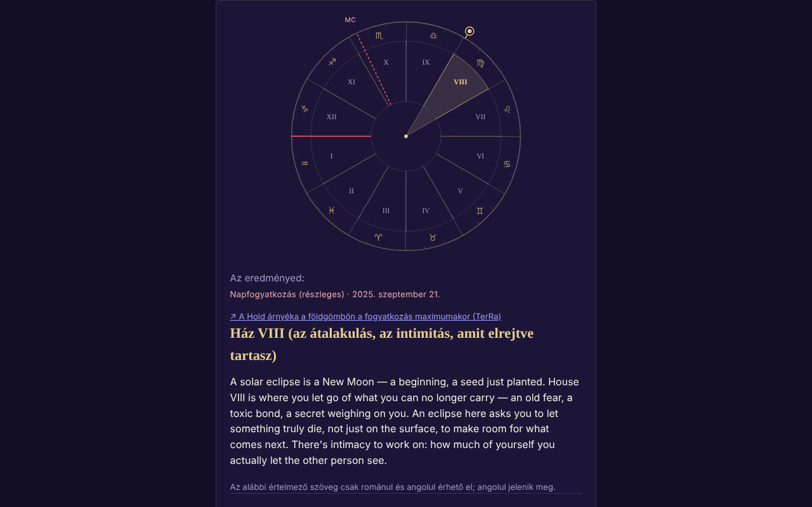

# ECLIPSA — a te házad a nap- vagy holdfogyatkozáskor

[English](README.md) · [Română](README.ro.md) · [Français](README.fr.md) · [Italiano](README.it.md) · [Español](README.es.md) · [Português](README.pt.md) · [Deutsch](README.de.md) · **Magyar**

**Verzió:** 1.3.0 · **Utolsó frissítés:** 2026-10-19

A felület nyelvei: **Română, English, Français, Italiano, Español, Português (PT), Deutsch, Magyar**

Egyfájlos alkalmazás, amely a születési adataid alapján megmondja, melyik asztrológiai születési házba esik egy fogyatkozás (212 fogyatkozás, 2024–2070).

**Élő verzió:** https://chiuta.github.io/ECLIPSA/

## Mi ez

Helyi csillagászati számítás (Nap, Hold, felkelő jegy, MC, házak) és szimbolikus szövegek minden házhoz. **Az asztrológiának nincs tudományos érvényesítése**: az értelmezések elgondolkodtatásra/szórakozásra szolgálnak, nem jóslatok, és nem orvosi, pénzügyi vagy jogi tanácsok.

## Funkciók

- Megadott házrendszerek: egész jegyek (alapértelmezett), egyenlő házak, Placidus. Születési időpont nélkül: napkártya (egész jegyek).
- Hozzávetőleges időpont (időköz, éjfélen átnyúlóan is): megmutatja az összes lehetséges házat.
- A fogyatkozáslista a NASA katalógusával ellenőrzött (dátumok és típusok: 106 napfogyatkozás + 106 holdfogyatkozás, mind egyezik); egyéni fogyatkozás is megadható.
- SVG-kerék, az eredmény másolása/letöltése, RO/EN.
- „A következő fogyatkozások a házaidban”: a számítás után egy összecsukható táblázat a következő 12 fogyatkozásról (a mai dátum után, a mellékelt NASA-listából) és arról a születési házról, amelybe mindegyik esik, ugyanazokkal a születési adatokkal és ugyanazzal a házrendszerrel (hozzávetőleges időpontnál az időköz felét használja, megjegyzéssel; időpont nélkül a napkártyát).
- Időzóna-javaslat a böngésző IANA-adatbázisából (történelmi nyári időszámítás); a mező magától kitöltődik a dátum, az időpont vagy a város kiválasztásakor, és szerkeszthető marad (a kézzel beírt értéket többé nem írja felül); a „Javasolj…” gomb bármikor újraszámolja.

## Új funkciók (1.1.0)

Egy összecsukható panel „Teljes napfogyatkozás 2027. augusztus 2-án — a te helyeden”, az eredmények alatt (az Eclipsa-2027 változatának kicsinyített mása), helyben, az `FFF.ephem` segítségével számolva:

- **Helyi körülmények:** a C1, C2, maximum, C3, C4 érintések (UTC és helyi idő, ha az időzóna ismert), magnitúdó, takarás, a teljesség és a részleges fázis időtartama, a Nap magassága/azimutja, a helyzet a teljességi sávhoz képest. A hely: keresés az alkalmazás városlistájában (Románia és a világ városai), `lat, lon` koordináták, a „Használd az űrlapon megadott helyet” gomb (az már kitöltött szélesség/hosszúság) vagy GPS.
- **GPS kifejezett, kétlépcsős beleegyezéssel** (megerősítés az oldalon, majd egyetlen kérés); semmi nem kerül mentésre vagy elküldésre.
- **Visszaszámlálás** a következő érintésig és „Gyakorlás” gomb (szimulált óra, a C2/maximum előtt 30 s-mal indul).
- **`.ics` export** (C1–C4 esemény, és teljesség esetén C2–C3; opcionális riasztások).
- **Ellenőrzőlista a biztonságos megfigyeléshez** (előrehaladással; nem mentődik).
- **Egyszerű térkép a sávról:** SVG a ritkított Natural Earth körvonallal (partok és határok) (≈ 14 KB, közkincs), az `FFF.ephem` által számolt teljességi sávval és középvonallal, a globális maximum pontjával és a te helyeddel. Nem interaktív térkép, és nincs csempés háttere; a körvonal durva (ritkított), és nem alkalmas pontos hely megtalálására.
- A felület 8 nyelvű (RO, EN, FR, IT, ES, PT, DE, HU), a nyelvválasztóból választható. A hosszú értelmezési szövegek RO/EN nyelven maradnak (a többi nyelven angol látszik). Az fr/it/es/pt/de/hu fordítások **automatikusak, és anyanyelvi beszélők nem ellenőrizték őket**.

## Használati útmutató

1. Töltsd ki a születési dátumot és (opcionálisan) az időpontot; válaszd ki a várost vagy a koordinátákat.
2. Nyomd meg az „Időzóna javaslata” gombot (kézzel javíthatod).
3. Válaszd ki a házrendszert és a fogyatkozást.
4. Nyomd meg a „Számítás” gombot.

## Adatvédelem és hálózat

- Nem használ tárolást, sütiket vagy fiókokat; nincs külső hoszt (CSP `connect-src 'none'`). Az adatok nem hagyják el az eszközt.
- Engedélyek: induláskor egyik sem; a helymeghatározás csak kifejezett kérésre, az oldalon történt megerősítés után.

- 1.1.0: a **helymeghatározást** csak akkor használja, ha megnyomod a „Saját helyzetem használata (GPS)” gombot, és megerősíted az oldalon. Az `.ics` export helyben, `Blob`-on keresztül töltődik le. Nincsenek új hálózati kérések. Az `fff-kit` (`core`, `label`, `bundle`, `ephem`) hozzáadja az átláthatóság gombot; az alkalmazás nem ír semmit a tárolóba (0 kulcs induláskor).
## Korlátok és figyelmeztetések

- Pontosság ~0,01° (Nap), ~0,1–0,3° (Hold, tájékoztató jellegű). A fogyatkozások időpontjai percre vannak kerekítve (±2 perc, gyakorlati hatás nélkül).
- A Placidus ~66° szélesség felett nincs értelmezve (az alkalmazás elutasítja); 89,5° felett nincs felkelő jegy.
- Időzóna: ~1970 előtt és az óraátállítás napján ellenőrizd kézzel; a születési dátum ≥ 1900.
- Az asztrológiának nincs tudományos alapja.

- **Új funkciók, valós korlátok.** Ugyanazok, mint az Eclipsa-2027-ben: az érintések tengerszintre vannak számolva (egyezés a DE421 referenciával: ≈ 1 s a maximumnál, ≤ 3 s az érintéseknél 10 helyen; a ΔT ≈ ±1 s bizonytalan 2027-ben), domborzat és a Hold peremprofilja nélkül; a teljesség időtartama a sáv szélén nagyon érzékeny. A visszaszámlálás az eszköz óráját használja. Nem biztonsági eszköz, és nem ad orvosi tanácsot; az ISO 12312-2 szűrők használata továbbra is kötelező.
- A meglévő asztrológiai számítást (házak, NASA-fogyatkozások 2024–2070) **nem** váltotta fel az `FFF.ephem`, és nem módosult; az új panel független tőle. A városlista nem tartalmaz helyeket a teljesség útvonalán Afrikában (Luxor, Cádiz): használd a koordinátákat.
## Előzmények / Changelog

### 1.2.0 — 2026-10-19
- Új: „↗ TerRa” — napfogyatkozásoknál hivatkozás a TerRához (2D térkép) a maximum pillanatában, a Hold árnyékával a földgömbön; nem tartalmazza a születési helyet. A „Fogyatkozás a te helyeden — 2027” panelen: ugyanaz a hivatkozás, a helyi maximumnál, a választott hellyel (~1 km-re kerekítve) „Saját helyzetem” néven.

### 1.1.0 — 2026-10-14
- Új: a „Fogyatkozás 2027. augusztus 2-án a te helyeden” panel (helyi körülmények, visszaszámlálás + gyakorlás, `.ics` export, ellenőrzőlista, egyszerű SVG-térkép a sávról, GPS kétlépcsős beleegyezéssel); RO/EN/HU/DE nyelvciklus az új funkciókhoz; `FFF.ephem` és `fff-kit` (`core`, `label`, `bundle`, `ephem`); `tests/fff-r8.test.mjs` (91 ellenőrzés). Előtte/utána összehasonlítás 1280×800-on: a kezdőoldal láthatóan változatlan (0 pixel a küszöböt meghaladó eltéréssel; a panel alapértelmezetten zárt), ezért a képernyőkép nem változott.

- 1.0.0 — 2026-10-12: a verzió és az utolsó frissítés dátuma megjelenik az alkalmazásban
- 7. kör: az időzóna már nem marad üresen a javaslat gomb megnyomásáig: automatikusan kitöltődik (az IANA-adatbázisból) a dátum/időpont/város változásakor, amíg kézzel nem írták be.
- Hozzáadva a „A következő fogyatkozások a házaidban” táblázat (RO/EN); CSP: `script-src` SHA-256 hash alapon, `'unsafe-inline'` nélkül.
- A motor önellenőrzése (2026.10.11., helyi számítás, nem külső efemerisz): a 2024.04.08-i, 2024.10.02-i és 2027.08.02-i fogyatkozásokra számolt Nap ~19°24′ Kos, ~10°04′ Mérleg, ~9°55′ Oroszlán pozícióba esik, összhangban azzal a jeggyel és fokkal, amelyben ezek a fogyatkozások ismertek; a külső efemerisszel való ellenőrzés továbbra is megoldatlan.
- Az űrlap és az eredmények `<main>` elembe vannak foglalva (akadálymentességi támpont); axe-core: 0 szabálysértés 1280 és 360 px szélességen.
- A lista alapértelmezett fogyatkozását dinamikusan választja (a jelenlegi dátumhoz képest a legutóbbi múltbeli fogyatkozás); a 212 NASA-fogyatkozás listája nem módosult.
- Megoldatlan: a referenciaeredményt (V. ház a 2024. október 2-i fogyatkozásra) nem lehetett függetlenül újraellenőrizni, mert a munkakörnyezetben nincs külső efemerisz.

## Tesztek

`node tests/fff-r8.test.mjs` (Playwright az `/opt/node-tools` könyvtárból, helyi Chromium, letiltott hálózat; a `tests/_lib.mjs` tartalmazza a közös segédfüggvényeket). A referenciaértékek a `tests/ref-c3a.json` fájlban vannak: a helyi körülmények 10 referenciahelyre (C1–C4 érintések, időtartam, takarás, a Nap magassága; JPL DE421, az `fff-kit/test/ref` könyvtárból), a kelés/nyugvás/átvonulás időpontjai (Nap, Hold; 5 hely × 4 dátum), 56 fázisidőpont és 54 alt/az pozíció, függetlenül, a **pyephem 4.2.1** segítségével számolva (csak offline használva a számok előállításához; nem része az alkalmazásnak). Minden teszt küszöbértéke a kódban van megadva; a kisegítő lehetőségek tesztje (axe-core, `bypassCSP`) a megnyitott párbeszédablakokban/paneleken is lefut, 1280×800 és 360×740 mellett.

## Helyi futtatás / offline

Töltsd le az `index.html` fájlt, és nyisd meg böngészőben.

## Licenc

MIT — lásd a LICENSE fájlt. Harmadik felek: az új panelen a kontinensek körvonala a Natural Earth-ből származik (közkincs), ritkítva; az `FFF.ephem` és az `fff-kit` a szerző kódja.

## Szerző

Alexio — Alexandru-Ionuț Chiuță, kapcsolat: alexio@trom.tf

## Összefoglaló

Offline, egyfájlos alkalmazás, amely megmondja, melyik születési házba (egész jegyek, egyenlő vagy Placidus) esik egy nap-/holdfogyatkozás, 212 fogyatkozásra 2024–2070 között (a NASA katalógusaival ellenőrizve). Helyi számítás, tárolás és hálózat nélkül. Az asztrológiának nincs tudományos érvényesítése; az értelmezések szimbolikusak.
