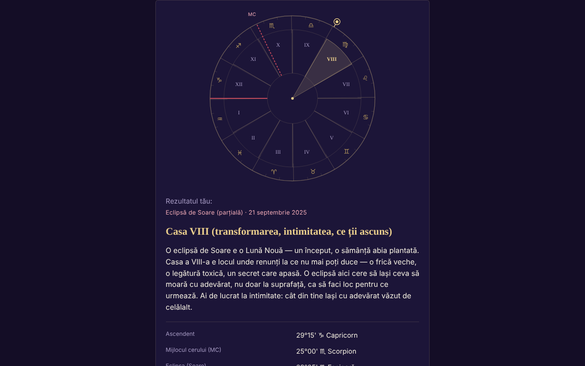

# ECLIPSA — la tua casa nell'eclissi di Sole o di Luna

[English](README.md) · [Română](README.ro.md) · [Français](README.fr.md) · **Italiano** · [Español](README.es.md) · [Português](README.pt.md) · [Deutsch](README.de.md) · [Magyar](README.hu.md)

**Versione:** 1.3.0 · **Ultimo aggiornamento:** 2026-10-19

Lingue dell'interfaccia: **Română, English, Français, Italiano, Español, Português (PT), Deutsch, Magyar**

App in un unico file che scopre in quale casa astrologica natale cade un'eclissi (212 eclissi 2024–2070) in base ai tuoi dati di nascita.

**Online:** https://chiuta.github.io/ECLIPSA/

## Che cos'è

Calcolo astronomico locale (Sole, Luna, ascendente, MC, case) più testi simbolici per ogni casa. **L'astrologia non ha validazione scientifica**: le interpretazioni sono riflessione/intrattenimento, non previsioni né consigli medici, finanziari o legali.

## Funzioni

- Sistemi di case dichiarati: segni interi (predefinito), case uguali, Placidus. Senza l'ora di nascita: carta solare (segni interi).
- Ora approssimativa (intervallo, anche a cavallo della mezzanotte): mostra tutte le case possibili.
- L'elenco delle eclissi è verificato rispetto al catalogo NASA (date e tipi: 106 solari + 106 lunari, tutte concordanti); è possibile un'eclissi personalizzata.
- Ruota SVG, copia/download del risultato, RO/EN.
- «Prossime eclissi nelle tue case»: dopo il calcolo, una tabella comprimibile con le successive 12 eclissi (dopo la data di oggi, dall'elenco NASA incluso) e la casa natale in cui cade ciascuna, con gli stessi dati di nascita e lo stesso sistema di case (per l'ora approssimativa si usa il punto medio dell'intervallo, con una nota; senza ora, la carta solare).
- Suggerimento del fuso orario dal database IANA del browser (ora legale storica); il campo si compila da solo quando scegli la data, l'ora o la città e resta modificabile (un valore scritto a mano non viene più sovrascritto); il pulsante «Suggerisci…» lo ricalcola in qualsiasi momento.

## Nuove funzioni (1.1.0)

Un pannello comprimibile «Eclissi totale del 2 agosto 2027 — nel tuo luogo», sotto i risultati (la versione ridotta di quello di Eclipsa-2027), calcolato localmente con `FFF.ephem`:

- **Circostanze locali:** i contatti C1, C2, massimo, C3, C4 (UTC e ora locale quando il fuso è noto), magnitudine, oscuramento, durata della totalità e della fase parziale, altezza/azimut del Sole, posizione rispetto alla fascia di totalità. Il luogo: ricerca nell'elenco di città dell'app (Romania e città del mondo), coordinate `lat, lon`, pulsante «Usa il luogo del modulo» (latitudine/longitudine già compilate) o GPS.
- **GPS con consenso esplicito in due passaggi** (conferma nella pagina, poi una sola richiesta); nulla viene salvato o inviato.
- **Conto alla rovescia** fino al prossimo contatto e pulsante «Prova» (orologio simulato, parte 30 s prima di C2/massimo).
- **Esportazione `.ics`** (evento C1–C4 e, in caso di totalità, C2–C3; allarmi opzionali).
- **Lista di controllo per l'osservazione in sicurezza** (con avanzamento; non viene salvata).
- **Mappa semplice della fascia:** SVG con il contorno Natural Earth (coste e confini) decimato (≈ 14 KB, pubblico dominio), la fascia di totalità e la linea centrale calcolate da `FFF.ephem`, il punto del massimo globale e il tuo luogo. Non è una mappa interattiva e non ha sfondo di tessere; il contorno è grossolano (decimato) e non è adatto a trovare un luogo preciso.
- L'interfaccia ha 8 lingue (RO, EN, FR, IT, ES, PT, DE, HU), scelte dal selettore di lingua. I testi lunghi di interpretazione restano in RO/EN (nelle altre lingue si vede l'inglese). Le traduzioni fr/it/es/pt/de/hu sono **automatiche e non verificate da madrelingua**.

## Manuale d'uso

1. Compila la data e (facoltativamente) l'ora di nascita; scegli la città o le coordinate.
2. Premi «Suggerisci il fuso orario» (puoi correggerlo a mano).
3. Scegli il sistema di case e l'eclissi.
4. Premi «Calcola».

## Privacy e rete

- Non usa archiviazione, cookie né account; nessun host esterno (CSP `connect-src 'none'`). I dati non lasciano il dispositivo.
- Permessi: nessuno all'avvio; la posizione solo su richiesta esplicita, dopo conferma nella pagina.

- 1.1.0: la **geolocalizzazione** viene usata solo se premi «Usa la mia posizione (GPS)» e confermi nella pagina. L'esportazione `.ics` si scarica localmente tramite `Blob`. Non ci sono nuove richieste di rete. Il kit `fff-kit` (`core`, `label`, `bundle`, `ephem`) aggiunge il pulsante di trasparenza; l'app non scrive nulla nell'archiviazione (0 chiavi all'avvio).
## Limiti e avvertenze

- Precisione ~0,01° (Sole), ~0,1–0,3° (Luna, indicativa). Gli orari delle eclissi sono arrotondati al minuto (±2 min, senza effetto pratico).
- Placidus non è definito oltre circa 66° di latitudine (l'app rifiuta); oltre 89,5° non esiste l'ascendente.
- Fuso orario: verifica a mano prima del ~1970 e nel giorno del cambio d'ora; data di nascita ≥ 1900.
- L'astrologia non ha base scientifica.

- **Nuove funzioni, limiti reali.** Gli stessi di Eclipsa-2027: i contatti sono calcolati per il livello del mare (concordanza con il riferimento DE421: ≈ 1 s al massimo, ≤ 3 s ai contatti in 10 luoghi; ΔT ≈ ±1 s incerto nel 2027), senza rilievo e senza il profilo del bordo lunare; la durata della totalità al margine della fascia è molto sensibile. Il conto alla rovescia usa l'orologio del dispositivo. Non è uno strumento di sicurezza e non offre consigli medici; i filtri ISO 12312-2 restano obbligatori.
- Il calcolo astrologico esistente (case, eclissi NASA 2024–2070) **non** è stato sostituito con `FFF.ephem` e non è stato modificato; il nuovo pannello è indipendente da esso. L'elenco delle città non contiene luoghi sul percorso della totalità in Africa (Luxor, Cadice): usa le coordinate.
## Cronologia / Changelog

### 1.2.0 — 2026-10-19
- Nuovo: «↗ TerRa» — per le eclissi di Sole, link a TerRa (mappa 2D) al momento del massimo, con l'ombra della Luna sul globo; non contiene il luogo di nascita. Nel pannello «Eclissi nel tuo luogo — 2027»: lo stesso link, al massimo locale, con il luogo scelto (arrotondato a ~1 km) come «La mia posizione».

### 1.1.0 — 2026-10-14
- Nuovo: il pannello «Eclissi del 2 agosto 2027 nel tuo luogo» (circostanze locali, conto alla rovescia + prova, esportazione `.ics`, lista di controllo, mappa SVG semplice della fascia, GPS con consenso in due passaggi); ciclo di lingue RO/EN/HU/DE per le nuove funzioni; `FFF.ephem` e `fff-kit` (`core`, `label`, `bundle`, `ephem`); `tests/fff-r8.test.mjs` (91 verifiche). Confronto prima/dopo a 1280×800: pagina iniziale visibilmente invariata (0 pixel con differenza sopra la soglia; il pannello è chiuso per impostazione predefinita), quindi la schermata non è cambiata.

- 1.0.0 — 2026-10-12: la versione e la data dell'ultimo aggiornamento sono mostrate nell'app
- Round 7: il fuso orario non resta più vuoto finché non si preme il pulsante di suggerimento: si compila automaticamente (dal database IANA) al cambio di data/ora/città, finché non è stato scritto a mano.
- Aggiunta la tabella «Prossime eclissi nelle tue case» (RO/EN); CSP: `script-src` tramite hash SHA-256, senza `'unsafe-inline'`.
- Autoverifica del motore (11.10.2026, calcolo locale, non un'effemeride esterna): il Sole calcolato per le eclissi dell'8.04.2024, del 2.10.2024 e del 2.08.2027 cade a ~19°24′ Ariete, ~10°04′ Bilancia, ~9°55′ Leone, coerente con il segno e il grado in cui queste eclissi sono note; la verifica rispetto a un'effemeride esterna resta irrisolta.
- Il modulo e i risultati sono racchiusi in `<main>` (punto di riferimento di accessibilità); axe-core: 0 violazioni a 1280 e 360 px.
- L'eclissi predefinita nell'elenco viene scelta dinamicamente (l'eclissi passata più recente rispetto alla data corrente); l'elenco delle 212 eclissi NASA non è stato modificato.
- Irrisolto: il risultato di riferimento (casa V per l'eclissi del 2 ottobre 2024) non ha potuto essere riverificato in modo indipendente, perché l'ambiente di lavoro non dispone di un'effemeride esterna.

## Test

`node tests/fff-r8.test.mjs` (Playwright da `/opt/node-tools`, Chromium locale, rete bloccata; `tests/_lib.mjs` contiene le funzioni di supporto comuni). I valori di riferimento sono in `tests/ref-c3a.json`: le circostanze locali per 10 luoghi di riferimento (contatti C1–C4, durata, oscuramento, altezza del Sole; JPL DE421, da `fff-kit/test/ref`), gli istanti di sorgere/tramontare/transito (Sole, Luna; 5 luoghi × 4 date), 56 istanti di fase e 54 posizioni alt/az, calcolati in modo indipendente con **pyephem 4.2.1** (usato solo offline per generare i numeri; non fa parte dell'app). Ogni test ha la soglia scritta nel codice; il test di accessibilità (axe-core, `bypassCSP`) viene eseguito anche nei dialoghi/pannelli aperti, a 1280×800 e 360×740.

## Esecuzione in locale / offline

Scarica `index.html` e aprilo nel browser.

## Licenza

MIT — vedi il file LICENSE. Terzi: il contorno dei continenti nel nuovo pannello proviene da Natural Earth (pubblico dominio), decimato; `FFF.ephem` e `fff-kit` sono codice dell'autore.

## Autore

Alexio — Alexandru-Ionuț Chiuță, contatto: alexio@trom.tf

## Riepilogo

App offline in un unico file che scopre in quale casa natale (segni interi, uguali o Placidus) cade un'eclissi solare/lunare, per 212 eclissi 2024–2070 (verificate rispetto ai cataloghi NASA). Calcolo locale, senza archiviazione né rete. L'astrologia non ha validazione scientifica; le interpretazioni sono simboliche.
