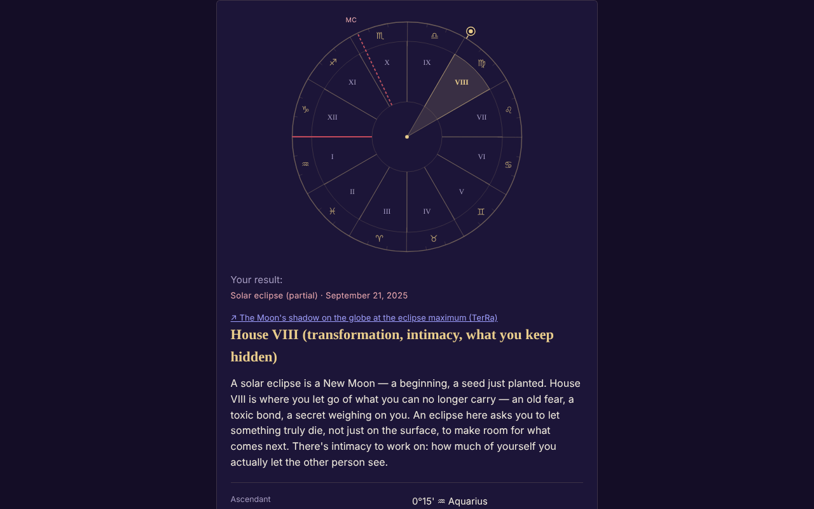

# ECLIPSA — your house at the solar or lunar eclipse

**English** · [Română](README.ro.md) · [Français](README.fr.md) · [Italiano](README.it.md) · [Español](README.es.md) · [Português](README.pt.md) · [Deutsch](README.de.md) · [Magyar](README.hu.md)

**Version:** 1.3.4 · **Last updated:** 2026-10-22

Interface languages: **Română, English, Français, Italiano, Español, Português (PT), Deutsch, Magyar**

A single-file app that finds which natal astrological house an eclipse falls in (212 eclipses 2024–2070), based on your birth data.

**Live:** https://chiuta.github.io/ECLIPSA/

## What it is

Local astronomical computation (Sun, Moon, ascendant, MC, houses) plus symbolic texts for each house. **Astrology has no scientific validation**: the interpretations are reflection/entertainment, not predictions and not medical, financial or legal advice.

## Features

- Declared house systems: whole signs (default), equal houses, Placidus. Without the birth time: solar chart (whole signs).
- Approximate time (an interval, including across midnight): shows all possible houses.
- The eclipse list is checked against the NASA catalog (dates and types: 106 solar + 106 lunar, all matching); a custom eclipse is possible.
- SVG wheel, copy/download of the result, RO/EN.
- "Upcoming eclipses in your houses": after the calculation, a collapsible table with the next 12 eclipses (after today's date, from the included NASA list) and the natal house each falls in, with the same birth data and the same house system (for the approximate time the midpoint of the interval is used, with a note; without a time, the solar chart).
- Time zone suggestion from the browser's IANA database (historical daylight saving time); the field fills itself in when you choose the date, the time or the city and stays editable (a manually typed value is no longer overwritten); the "Suggest…" button recomputes it at any time.

## New features (1.1.0)

A collapsible panel "Total eclipse of 2 August 2027 — at your location", below the results (a small version of the one in Eclipsa-2027), computed locally with `FFF.ephem`:

- **Local circumstances:** the contacts C1, C2, maximum, C3, C4 (UTC and local time when the time zone is known), magnitude, obscuration, the duration of totality and of the partial phase, the Sun's altitude/azimuth, the position relative to the totality band. The location: a search in the app's city list (Romania and cities worldwide), `lat, lon` coordinates, the "Use the place from the form" button (the latitude/longitude already filled in) or GPS.
- **GPS with explicit two-step consent** (confirmation in the page, then a single request); nothing is saved or sent.
- **Countdown** to the next contact and a "Rehearsal" button (simulated clock, starts 30 s before C2/maximum).
- **`.ics` export** (an event C1–C4 and, for totality, C2–C3; optional alarms).
- **Checklist for safe observation** (with progress; not saved).
- **Simple map of the band:** an SVG with the decimated Natural Earth outline (coasts and borders) (≈ 14 KB, public domain), the totality band and the central line computed by `FFF.ephem`, the point of global maximum and your location. It is not an interactive map and has no tile background; the outline is coarse (decimated) and not suitable for finding an exact place.
- The interface has 8 languages (RO, EN, FR, IT, ES, PT, DE, HU), chosen from the language selector. The long interpretation texts remain in RO/EN (in the other languages English is shown). The fr/it/es/pt/de/hu translations are **automatic and not verified by native speakers**.

## User guide

1. Fill in the date and (optionally) the time of birth; choose the city or the coordinates.
2. Press "Suggest time zone" (you can correct it manually).
3. Choose the house system and the eclipse.
4. Press "Calculate".

## Privacy and network

- It uses no storage, cookies or accounts; no external host (CSP `connect-src 'none'`). The data never leaves the device.
- Permissions: none at startup; location only on explicit request, after confirmation in the page.

- 1.1.0: **geolocation** is used only if you press "Use my location (GPS)" and confirm in the page. The `.ics` export is downloaded locally through a `Blob`. There are no new network requests. The `fff-kit` (`core`, `label`, `bundle`, `ephem`) adds the transparency button; the app writes nothing to storage (0 keys at startup).
## Limits and warnings

- Precision ~0.01° (Sun), ~0.1–0.3° (Moon, informative). Eclipse times are rounded to the minute (±2 min, no practical effect).
- Placidus is not defined above ~66° latitude (the app refuses); above 89.5° there is no ascendant.
- Time zone: check manually before ~1970 and on the day of a clock change; birth date ≥ 1900.
- Astrology has no scientific basis.

- **New features, real limits.** The same as in Eclipsa-2027: the contacts are computed for sea level (agreement with the DE421 reference: ≈ 1 s at maximum, ≤ 3 s at contacts at 10 places; ΔT ≈ ±1 s uncertain in 2027), without terrain and without the profile of the Moon's limb; the duration of totality at the edge of the band is very sensitive. The countdown uses the device clock. It is not a safety tool and gives no medical advice; ISO 12312-2 filters remain mandatory.
- The existing astrological calculation (houses, NASA eclipses 2024–2070) was **not** replaced with `FFF.ephem` and was not modified; the new panel is independent of it. The city list does not contain places on the totality path in Africa (Luxor, Cádiz): use the coordinates.
## History / Changelog

### 1.3.4 — 2026-10-22

fff-kit 1.1.4: touch targets and minimum text size.

### 1.3.3 — 2026-10-22

fff-kit 1.1.2: PBKDF2 with 600,000 iterations, anti-clickjacking protection.

### 1.3.2 — 2026-10-22
- Radio buttons and checkboxes of 24 px; small text raised to 12 px.

### 1.2.0 — 2026-10-19
- New: "↗ TerRa" — for solar eclipses, a link to TerRa (2D map) at the moment of maximum, with the Moon's shadow on the globe; it does not contain the birthplace. In the "Eclipse at your location — 2027" panel: the same link, at the local maximum, with the chosen place (rounded to ~1 km) as "My location".

### 1.1.0 — 2026-10-14
- New: the panel "Eclipse of 2 August 2027 at your location" (local circumstances, countdown + rehearsal, `.ics` export, checklist, simple SVG map of the band, GPS with two-step consent); RO/EN/HU/DE language cycle for the new features; `FFF.ephem` and `fff-kit` (`core`, `label`, `bundle`, `ephem`); `tests/fff-r8.test.mjs` (91 checks). Before/after comparison at 1280×800: the initial page unchanged visibly (0 pixels with a difference above the threshold; the panel is closed by default), so the screenshot did not change.

- 1.0.0 — 2026-10-12: the version and the date of the last update are shown in the app
- Round 7: the time zone no longer stays empty until the suggestion button is pressed: it is filled in automatically (from the IANA database) when the date/time/city changes, as long as it has not been typed manually.
- Added the "Upcoming eclipses in your houses" table (RO/EN); CSP: `script-src` by SHA-256 hash, without `'unsafe-inline'`.
- Engine self-check (11.10.2026, local computation, not an external ephemeris): the Sun computed for the eclipses of 8.04.2024, 2.10.2024 and 2.08.2027 falls at ~19°24′ Aries, ~10°04′ Libra, ~9°55′ Leo, consistent with the sign and degree in which these eclipses are known; verification against an external ephemeris remains unresolved.
- The form and the results are wrapped in `<main>` (accessibility landmark); axe-core: 0 violations at 1280 and 360 px.
- The default eclipse in the list is chosen dynamically (the most recent past eclipse relative to the current date); the list of 212 NASA eclipses was not modified.
- Unresolved: the reference result (house V for the eclipse of 2 October 2024) could not be re-verified independently, because the working environment has no external ephemeris.

## Tests

`node tests/fff-r8.test.mjs` (Playwright from `/opt/node-tools`, local Chromium, network blocked; `tests/_lib.mjs` has the shared helpers). The reference values are in `tests/ref-c3a.json`: the local circumstances for 10 reference places (contacts C1–C4, duration, obscuration, Sun's altitude; JPL DE421, from `fff-kit/test/ref`), the sunrise/sunset/transit times (Sun, Moon; 5 places × 4 dates), 56 phase moments and 54 alt/az positions, computed independently with **pyephem 4.2.1** (used only offline to generate the numbers; it is not part of the app). Each test has its threshold written in the code; the accessibility test (axe-core, `bypassCSP`) also runs in open dialogs/panels, at 1280×800 and 360×740.

## Running locally / offline

Download `index.html` and open it in a browser.

## License

MIT — see the LICENSE file. Third parties: the continents' outline in the new panel comes from Natural Earth (public domain), decimated; `FFF.ephem` and `fff-kit` are the author's code.

## Author

Alexio — Alexandru-Ionuț Chiuță, contact: alexio@trom.tf

## Summary

Offline single-file app that finds which natal house (whole sign, equal, or Placidus) a solar/lunar eclipse falls in, for 212 eclipses 2024–2070 (checked against NASA's catalogs). Local computation, no storage or network. Astrology has no scientific validation; interpretations are symbolic.
