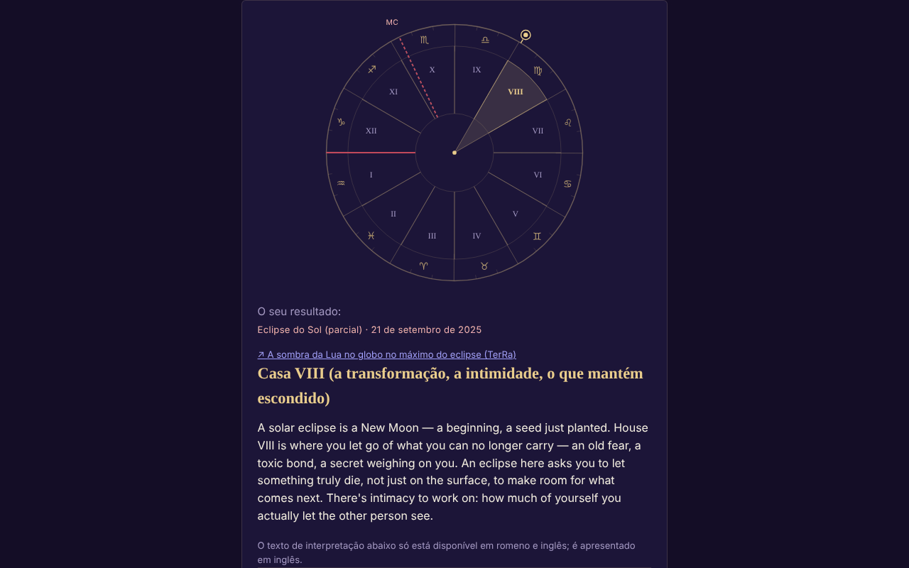

# ECLIPSA — a tua casa no eclipse do Sol ou da Lua

[English](README.md) · [Română](README.ro.md) · [Français](README.fr.md) · [Italiano](README.it.md) · [Español](README.es.md) · **Português** · [Deutsch](README.de.md) · [Magyar](README.hu.md)

**Versão:** 1.3.7 · **Última atualização:** 2026-10-26

Idiomas da interface: **Română, English, Français, Italiano, Español, Português (PT), Deutsch, Magyar**

Aplicação de ficheiro único que descobre em que casa astrológica natal cai um eclipse (212 eclipses 2024–2070) com base nos teus dados de nascimento.

**Online:** https://chiuta.github.io/ECLIPSA/

## O que é

Cálculo astronómico local (Sol, Lua, ascendente, MC, casas) mais textos simbólicos para cada casa. **A astrologia não tem validação científica**: as interpretações são reflexão/entretenimento, não previsões nem aconselhamento médico, financeiro ou jurídico.

## Funcionalidades

- Sistemas de casas declarados: signos inteiros (predefinição), casas iguais, Placidus. Sem a hora de nascimento: mapa solar (signos inteiros).
- Hora aproximada (intervalo, incluindo para lá da meia-noite): mostra todas as casas possíveis.
- A lista de eclipses é verificada com o catálogo da NASA (datas e tipos: 106 solares + 106 lunares, todos concordantes); é possível um eclipse personalizado.
- Roda SVG, cópia/transferência do resultado, RO/EN.
- «Próximos eclipses nas tuas casas»: após o cálculo, uma tabela recolhível com os 12 eclipses seguintes (depois da data de hoje, a partir da lista NASA incluída) e a casa natal em que cai cada um, com os mesmos dados de nascimento e o mesmo sistema de casas (para a hora aproximada usa-se o ponto médio do intervalo, com uma nota; sem hora, o mapa solar).
- Sugestão de fuso horário a partir da base de dados IANA do navegador (hora de verão histórica); o campo preenche-se sozinho ao escolher a data, a hora ou a cidade e continua editável (um valor escrito à mão deixa de ser substituído); o botão «Sugerir…» recalcula-o a qualquer momento.

## Novas funcionalidades (1.1.0)

Um painel recolhível «Eclipse total de 2 de agosto de 2027 — no teu local», por baixo dos resultados (a versão reduzida da do Eclipsa-2027), calculado localmente com `FFF.ephem`:

- **Circunstâncias locais:** os contactos C1, C2, máximo, C3, C4 (UTC e hora local quando o fuso é conhecido), magnitude, obscurecimento, duração da totalidade e da fase parcial, altura/azimute do Sol, posição relativamente à faixa de totalidade. O local: pesquisa na lista de cidades da aplicação (Roménia e cidades do mundo), coordenadas `lat, lon`, botão «Usar o local do formulário» (latitude/longitude já preenchidas) ou GPS.
- **GPS com consentimento explícito em dois passos** (confirmação na página, depois um único pedido); nada é guardado nem enviado.
- **Contagem decrescente** até ao próximo contacto e botão «Ensaio» (relógio simulado, começa 30 s antes de C2/máximo).
- **Exportação `.ics`** (evento C1–C4 e, em caso de totalidade, C2–C3; alarmes opcionais).
- **Lista de verificação para observar em segurança** (com progresso; não é guardada).
- **Mapa simples da faixa:** SVG com o contorno do Natural Earth (costas e fronteiras) decimado (≈ 14 KB, domínio público), a faixa de totalidade e a linha central calculadas por `FFF.ephem`, o ponto do máximo global e o teu local. Não é um mapa interativo e não tem fundo de mosaicos; o contorno é grosseiro (decimado) e não serve para encontrar um local exato.
- A interface tem 8 línguas (RO, EN, FR, IT, ES, PT, DE, HU), escolhidas no seletor de língua. Os textos longos de interpretação permanecem em RO/EN (nas outras línguas vê-se inglês). As traduções fr/it/es/pt/de/hu são **automáticas e não verificadas por falantes nativos**.

## Manual de utilização

1. Preenche a data e (opcionalmente) a hora de nascimento; escolhe a cidade ou as coordenadas.
2. Prime «Sugerir fuso horário» (podes corrigi-lo à mão).
3. Escolhe o sistema de casas e o eclipse.
4. Prime «Calcular».

## Privacidade e rede

- Não usa armazenamento, cookies nem contas; nenhum anfitrião externo (CSP `connect-src 'none'`). Os dados não saem do dispositivo.
- Permissões: nenhuma no arranque; a localização apenas a pedido explícito, após confirmação na página.

- 1.1.0: a **geolocalização** só é usada se premires «Usar a minha localização (GPS)» e confirmares na página. A exportação `.ics` é transferida localmente através de um `Blob`. Não há novos pedidos de rede. O kit `fff-kit` (`core`, `label`, `bundle`, `ephem`) acrescenta o botão de transparência; a aplicação não escreve nada no armazenamento (0 chaves no arranque).
## Limites e avisos

- Precisão ~0,01° (Sol), ~0,1–0,3° (Lua, informativa). As horas dos eclipses são arredondadas ao minuto (±2 min, sem efeito prático).
- O Placidus não está definido acima de ~66° de latitude (a aplicação recusa); acima de 89,5° não existe ascendente.
- Fuso horário: verifica à mão antes de ~1970 e no dia da mudança de hora; data de nascimento ≥ 1900.
- A astrologia não tem base científica.

- **Novas funcionalidades, limites reais.** Os mesmos do Eclipsa-2027: os contactos são calculados para o nível do mar (concordância com a referência DE421: ≈ 1 s no máximo, ≤ 3 s nos contactos em 10 locais; ΔT ≈ ±1 s incerto em 2027), sem relevo e sem o perfil do bordo da Lua; a duração da totalidade no limite da faixa é muito sensível. A contagem decrescente usa o relógio do dispositivo. Não é uma ferramenta de segurança e não dá aconselhamento médico; os filtros ISO 12312-2 continuam obrigatórios.
- O cálculo astrológico existente (casas, eclipses NASA 2024–2070) **não** foi substituído por `FFF.ephem` e não foi modificado; o novo painel é independente dele. A lista de cidades não contém locais no percurso da totalidade em África (Luxor, Cádis): usa as coordenadas.
## Histórico / Changelog

### 1.3.4 — 2026-10-22

fff-kit 1.1.4: áreas de toque e texto mínimo.

### 1.3.3 — 2026-10-22

fff-kit 1.1.2: PBKDF2 com 600.000 iterações, proteção anti-clickjacking.

### 1.3.2 — 2026-10-22
- Botões de opção e caixas de seleção de 24 px; texto pequeno elevado para 12 px.

### 1.2.0 — 2026-10-19
- Novo: «↗ TerRa» — nos eclipses do Sol, ligação ao TerRa (mapa 2D) no momento do máximo, com a sombra da Lua no globo; não contém o local de nascimento. No painel «Eclipse no teu local — 2027»: a mesma ligação, no máximo local, com o local escolhido (arredondado a ~1 km) como «A minha localização».

### 1.1.0 — 2026-10-14
- Novo: o painel «Eclipse de 2 de agosto de 2027 no teu local» (circunstâncias locais, contagem decrescente + ensaio, exportação `.ics`, lista de verificação, mapa SVG simples da faixa, GPS com consentimento em dois passos); ciclo de línguas RO/EN/HU/DE para as novas funcionalidades; `FFF.ephem` e `fff-kit` (`core`, `label`, `bundle`, `ephem`); `tests/fff-r8.test.mjs` (91 verificações). Comparação antes/depois a 1280×800: a página inicial não muda visivelmente (0 píxeis com diferença acima do limiar; o painel está fechado por omissão), pelo que a captura de ecrã não mudou.

- 1.0.0 — 2026-10-12: a versão e a data da última atualização são apresentadas na aplicação
- Ronda 7: o fuso horário já não fica vazio até se premir o botão de sugestão: é preenchido automaticamente (a partir da base IANA) quando a data/hora/cidade muda, enquanto não tiver sido escrito à mão.
- Adicionada a tabela «Próximos eclipses nas tuas casas» (RO/EN); CSP: `script-src` por hash SHA-256, sem `'unsafe-inline'`.
- Autoverificação do motor (11.10.2026, cálculo local, não uma efeméride externa): o Sol calculado para os eclipses de 8.04.2024, 2.10.2024 e 2.08.2027 cai em ~19°24′ Carneiro, ~10°04′ Balança, ~9°55′ Leão, coerente com o signo e o grau em que estes eclipses são conhecidos; a verificação com uma efeméride externa continua por resolver.
- O formulário e os resultados estão envolvidos em `<main>` (ponto de referência de acessibilidade); axe-core: 0 violações a 1280 e 360 px.
- O eclipse predefinido da lista é escolhido dinamicamente (o eclipse passado mais recente relativamente à data atual); a lista de 212 eclipses NASA não foi modificada.
- Por resolver: o resultado de referência (casa V para o eclipse de 2 de outubro de 2024) não pôde ser reverificado de forma independente, porque o ambiente de trabalho não tem uma efeméride externa.

## Testes

`node tests/fff-r8.test.mjs` (Playwright a partir de `/opt/node-tools`, Chromium local, rede bloqueada; `tests/_lib.mjs` contém os auxiliares comuns). Os valores de referência estão em `tests/ref-c3a.json`: as circunstâncias locais para 10 locais de referência (contactos C1–C4, duração, obscurecimento, altura do Sol; JPL DE421, de `fff-kit/test/ref`), os instantes de nascer/pôr/trânsito (Sol, Lua; 5 locais × 4 datas), 56 instantes de fase e 54 posições alt/az, calculados de forma independente com **pyephem 4.2.1** (usado apenas offline para gerar os números; não faz parte da aplicação). Cada teste tem o seu limiar escrito no código; o teste de acessibilidade (axe-core, `bypassCSP`) corre também em diálogos/painéis abertos, a 1280×800 e 360×740.

## Execução local / offline

Transfere `index.html` e abre-o num navegador.

## Licença

MIT — ver o ficheiro LICENSE. Terceiros: o contorno dos continentes do novo painel provém do Natural Earth (domínio público), decimado; `FFF.ephem` e `fff-kit` são código do autor.

## Autor

Alexio — Alexandru-Ionuț Chiuță, contacto: alexio@trom.tf

## Resumo

Aplicação offline de ficheiro único que descobre em que casa natal (signos inteiros, iguais ou Placidus) cai um eclipse solar/lunar, para 212 eclipses 2024–2070 (verificados com os catálogos da NASA). Cálculo local, sem armazenamento nem rede. A astrologia não tem validação científica; as interpretações são simbólicas.
