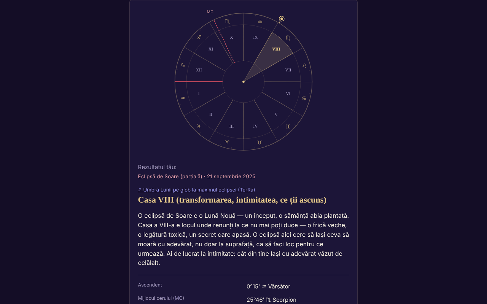

# ECLIPSA — casa ta la eclipsa de Soare sau de Lună

[English](README.md) · **Română** · [Français](README.fr.md) · [Italiano](README.it.md) · [Español](README.es.md) · [Português](README.pt.md) · [Deutsch](README.de.md) · [Magyar](README.hu.md)

**Versiune:** 1.3.3 · **Ultima actualizare:** 2026-10-22

Limbile interfeței: **Română, English, Français, Italiano, Español, Português (PT), Deutsch, Magyar**

Aplicație single-file care află în ce casă astrologică natală cade o eclipsă (212 eclipse 2024–2070) pe baza datelor tale de naștere.

**Live:** https://chiuta.github.io/ECLIPSA/

## Ce este

Calcul astronomic local (Soare, Lună, ascendent, MC, case) plus texte simbolice pentru fiecare casă. **Astrologia nu are validare științifică**: interpretările sunt reflecție/divertisment, nu predicții și nu sfat medical, financiar sau juridic.

## Funcții

- Sisteme de case declarate: semne întregi (implicit), case egale, Placidus. Fără ora nașterii: hartă solară (semne întregi).
- Ora aproximativă (interval, inclusiv peste miezul nopții): arată toate casele posibile.
- Lista de eclipse verificată față de catalogul NASA (date și tipuri: 106 solare + 106 lunare, toate concordante); eclipsă personalizată posibilă.
- Roată SVG, copiere/descărcare rezultat, RO/EN.
- „Următoarele eclipse în casele tale”: după calcul, un tabel pliabil cu următoarele 12 eclipse (după data de azi, din lista NASA inclusă) și casa natală în care cade fiecare, cu aceleași date de naștere și același sistem de case (la ora aproximativă se folosește mijlocul intervalului, cu notă; fără oră, harta solară).
- Sugestie de fus orar din baza IANA a browserului (ora de vară istorică); câmpul se completează singur la alegerea datei, a orei sau a orașului și rămâne editabil (o valoare scrisă manual nu se mai suprascrie); butonul „Sugerează…” o recalculează oricând.

## Funcții noi (1.1.0)

Un panou pliabil „Eclipsa totală din 2 august 2027 — la locul tău”, sub rezultate (varianta mică a celei din Eclipsa-2027), calculat local cu `FFF.ephem`:

- **Circumstanțe locale:** contactele C1, C2, maxim, C3, C4 (UTC și ora locală când fusul e cunoscut), magnitudine, obscurare, durata totalității și a fazei parțiale, altitudinea/azimutul Soarelui, poziția față de banda totalității. Locul: căutare în lista de orașe a aplicației (România și orașe din lume), coordonate `lat, lon`, butonul „Folosește locul din formular” (latitudinea/longitudinea deja completate) sau GPS.
- **GPS cu consimțământ explicit în două trepte** (confirmare în pagină, apoi o singură cerere); nimic nu se salvează sau se trimite.
- **Numărătoare inversă** până la următorul contact și buton „Repetiție” (ceas simulat, pornește cu 30 s înainte de C2/maxim).
- **Export `.ics`** (eveniment C1–C4 și, la totalitate, C2–C3; alarme opționale).
- **Listă de verificare pentru observarea în siguranță** (cu progres; nu se salvează).
- **Hartă simplă a benzii:** SVG cu conturul Natural Earth (coaste și granițe) decimat (≈ 14 KB, domeniu public), banda totalității și linia centrală calculate de `FFF.ephem`, punctul maximului global și locul tău. Nu este hartă interactivă și nu are fundal de tile-uri; conturul e grosier (decimat) și nu e potrivit pentru a găsi un loc exact.
- Interfața are 8 limbi (RO, EN, FR, IT, ES, PT, DE, HU), alese din selectorul de limbă. Textele lungi de interpretare rămân în RO/EN (în celelalte limbi se vede engleza). Traducerile fr/it/es/pt/de/hu sunt **automate și neverificate nativ**.

## Manual de utilizare

1. Completează data și (opțional) ora nașterii; alege orașul sau coordonatele.
2. Apasă „Sugerează fusul orar” (poți corecta manual).
3. Alege sistemul de case și eclipsa.
4. Apasă „Calculează”.

## Confidențialitate și rețea

- Nu folosește storage, cookie-uri, conturi; nicio gazdă externă (CSP `connect-src 'none'`). Datele nu părăsesc dispozitivul.
- Permisiuni: niciuna la pornire; locația doar la cerere explicită, după confirmare în pagină.

- 1.1.0: **geolocația** se folosește doar dacă apeși „Folosește locația mea (GPS)” și confirmi în pagină. Exportul `.ics` se descarcă local prin `Blob`. Nu există cereri de rețea noi. Kitul `fff-kit` (`core`, `label`, `bundle`, `ephem`) adaugă butonul de transparență; aplicația nu scrie nimic în storage (0 chei la pornire).
## Limite și avertismente

- Precizie ~0,01° (Soare), ~0,1–0,3° (Lună, informativă). Orele eclipselor sunt rotunjite la minut (±2 min, fără efect practic).
- Placidus nu e definit peste ~66° latitudine (aplicația refuză); peste 89,5° nu există ascendent.
- Fusul orar: verifică manual înainte de ~1970 și în ziua schimbării orei; data nașterii ≥ 1900.
- Astrologia nu are bază științifică.

- **Funcții noi, limite reale.** Aceleași ca în Eclipsa-2027: contactele sunt calculate pentru nivelul mării (concordanță cu referința DE421: ≈ 1 s la maxim, ≤ 3 s la contacte pe 10 locuri; ΔT ≈ ±1 s incert în 2027), fără relief și fără profilul marginii Lunii; durata totalității la marginea benzii e foarte sensibilă. Numărătoarea folosește ceasul dispozitivului. Nu este instrument de siguranță și nu oferă sfat medical; filtrele ISO 12312-2 rămân obligatorii.
- Calculul astrologic existent (case, eclipse NASA 2024–2070) **nu** a fost înlocuit cu `FFF.ephem` și nu a fost modificat; panoul nou este independent de el. Lista de orașe nu conține locuri pe traseul totalității în Africa (Luxor, Cádiz): folosește coordonatele.
## Istoric / Changelog

### 1.3.3 — 2026-10-22

fff-kit 1.1.2: PBKDF2 600 000 iterații, protecție anti-clickjacking.

### 1.3.2 — 2026-10-22
- Butoane radio și căsuțe de bifat de 24 px; textul mic ridicat la 12 px.

### 1.2.0 — 2026-10-19
- Nou: „↗ TerRa” — la eclipsele de Soare, link spre TerRa (hartă 2D) la momentul maximului, cu umbra Lunii pe glob; nu conține locul nașterii. În panoul „Eclipsa la locul tău — 2027”: același link, la maximul local, cu locul ales (rotunjit la ~1 km) ca „Locația mea”.

### 1.1.0 — 2026-10-14
- Nou: panoul „Eclipsa din 2 august 2027 la locul tău” (circumstanțe locale, numărătoare + repetiție, export `.ics`, listă de verificare, hartă SVG simplă a benzii, GPS cu consimțământ în două trepte); ciclu de limbi RO/EN/HU/DE pentru funcțiile noi; `FFF.ephem` și `fff-kit` (`core`, `label`, `bundle`, `ephem`); `tests/fff-r8.test.mjs` (91 de verificări). Comparație înainte/după la 1280×800: pagina inițială neschimbată vizibil (0 pixeli cu diferență peste prag; panoul e închis implicit), deci captura de ecran nu s-a schimbat.

- 1.0.0 — 2026-10-12: versiunea și data ultimei actualizări sunt afișate în aplicație
- Runda 7: fusul orar nu mai rămâne gol până la apăsarea butonului de sugestie: se completează automat (din baza IANA) la schimbarea datei/orei/orașului, cât timp nu a fost scris manual.
- Adăugat tabelul „Următoarele eclipse în casele tale” (RO/EN); CSP: `script-src` pe hash SHA-256, fără `'unsafe-inline'`.
- Autoverificare a motorului (11.10.2026, calcul local, nu efemeridă externă): Soarele calculat pentru eclipsele din 8.04.2024, 2.10.2024 și 2.08.2027 cade la ~19°24′ Berbec, ~10°04′ Balanță, ~9°55′ Leu, coerent cu semnul și gradul în care sunt cunoscute aceste eclipse; verificarea față de o efemeridă externă rămâne nerezolvată.
- Formularul și rezultatele sunt încadrate în `<main>` (reper de accesibilitate); axe-core: 0 violări la 1280 și 360 px.
- Eclipsa implicită din listă se alege dinamic (cea mai recentă eclipsă trecută față de data curentă); lista de 212 eclipse NASA nu a fost modificată.
- Nerezolvat: rezultatul de referință (casa V pentru eclipsa din 2 octombrie 2024) nu a putut fi reverificat independent, fiindcă mediul de lucru nu are o efemeridă externă.

## Teste

`node tests/fff-r8.test.mjs` (Playwright din `/opt/node-tools`, Chromium local, rețeaua blocată; `tests/_lib.mjs` are ajutoarele comune). Valorile de referință sunt în `tests/ref-c3a.json`: circumstanțele locale pentru 10 locuri de referință (contacte C1–C4, durata, obscurare, altitudinea Soarelui; JPL DE421, din `fff-kit/test/ref`), momentele de răsărit/apus/trecere (Soare, Lună; 5 locuri × 4 date), 56 de momente de fază și 54 de poziții alt/az, calculate independent cu **pyephem 4.2.1** (folosit doar offline pentru a genera numerele; nu face parte din aplicație). Fiecare test are pragul scris în cod; testul de accesibilitate (axe-core, `bypassCSP`) rulează și în dialoguri/panouri deschise, la 1280×800 și 360×740.

## Rulare locală / offline

Descarcă `index.html` și deschide-l în browser.

## Licență

MIT — vezi fișierul LICENSE. Terți: conturul continentelor din panoul nou provine din Natural Earth (domeniu public), decimat; `FFF.ephem` și `fff-kit` sunt codul autorului.

## Autor

Alexio — Alexandru-Ionuț Chiuță, contact: alexio@trom.tf

## Rezumat

Aplicație offline într-un singur fișier care găsește în ce casă natală (semn întreg, egală sau Placidus) cade o eclipsă de Soare/Lună, pentru 212 eclipse din 2024–2070 (verificate față de cataloagele NASA). Calcul local, fără stocare sau rețea. Astrologia nu are validare științifică; interpretările sunt simbolice.
